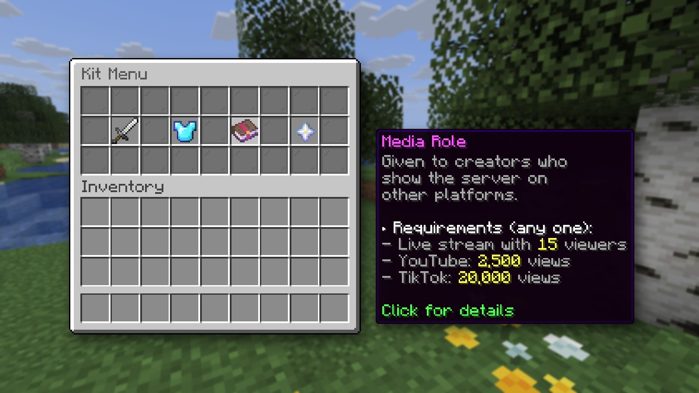

# GUI capture acceptance: menus and lore on a transparent background

Date: 2026-10-13 · Hub 0.10.0 (branch `feat/m10-build`) · Windows 11, Java 26.0.1, Node 24.9, ffmpeg 8.1.1 (full build)

## Setup

A throwaway Paper 26.2 server with the Craftwire plugin, a hub started with `craftwire serve` and a scratch driver
that calls one tool at a time. A hidden 26.2 client (`client_process start`, 1920 x 1080, sound on) joined as an
opped player. A demo "Kit Menu" (a 27-slot chest built with `server_eval`) holds four items with coloured names and
lore: a sword, a diamond chestplate with the enchantment glint, a "Media Role" enchanted book with ten lines of lore,
and a nether star.

The client ran at 1920 x 1080, not 4K: GPU caution on the test machine. `guiScale:4` gives the same panel size a 4K
window gets at scale 8, so the result is the same apart from the pixel count.

## Images

```jsonc
gui_action {action:"hover", slot:14}
screenshot {layer:"gui+tooltip", split:true, guiScale:4, savePath:"kit.png"}
```

| file | size | mode | corner pixel | inside |
|---|---|---|---|---|
| `kit.gui.png` | 720 x 684 | RGBA | `(0,0,0,0)` | panel `(198,198,198,255)` |
| `kit.tooltip.png` | 640 x 488 | RGBA | `(0,0,0,0)` | tooltip background `(16,0,16,240)`, see-through as in game |

Both are trimmed to their content plus 8 px. Over a checkerboard the menu, its items (the chestplate's glint
included) and the coloured lore are complete with no dark fringe.

## Videos

`record {action:"start", layer:"gui+tooltip", savePath:"kit.mov", durationMs:6500, wait:true}` while `gui_action`
moved the hover from slot to slot:

- 195 frames at 30 fps, 0 dropped, sound on, 37 MB.
- `ffprobe`: video `prores` (ProRes 4444), `yuva444p12le`; audio `aac`.
- Frames decoded to RGBA keep a transparent corner, and the tooltip follows the hover (sword, then the book).

`record {action:"start", layer:"gui+tooltip", savePath:"kit.webm", durationMs:3000, wait:true}`:

- 90 frames at 30 fps, 0 dropped, sound on, 62 KB.
- `ffprobe`: video `vp9` with `ALPHA_MODE=1`; audio `opus`.
- Decoded with `-c:v libvpx-vp9` (the decoder that reads the alpha), frames are RGBA with a transparent corner and
  the menu and tooltip intact.

A refusal was seen live too: a transparent layer with no `savePath` (MP4 by default) returns
`INVALID_PARAMS` naming `.mov` and `.webm`.

## Result

The two PNGs placed over a world shot taken with `screenshot {hud:false}`, with a drop shadow, as a video editor
would:


