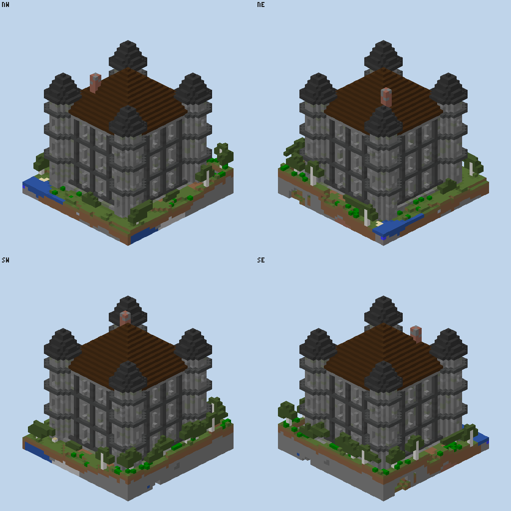

# M10 acceptance: build tools and the token diet

Date: 2026-10-13 · Hub 0.10.0 (branch `feat/m10-build`) · Windows 11, Java 26.0.1, Node 24.9

## Tower task (throwaway Paper 26.2 server, separate `CRAFTWIRE_HOME`)

A hub started with `craftwire serve --port 7790 --build-dir <dir>` and a scratch driver that logs, for every tool call,
the characters of its arguments and of its result text, and each image's token estimate (`w*h/750`). Starting the
server (`server_process start`) is setup and not counted. The task: a 25 x 25 keep, about 40 high, three floors with
stairs, framed windows, a hip roof with overhang and a mixed stone palette, in a forest near spawn.

| # | call | args | result text | image tokens | why |
|---|---|---:|---:|---:|---|
| 1 | `world_render {view:"top", grid:16}` 128 x 128 | 61 | 253 | 1,459 | pick a spot (all land near spawn is forest) |
| 2 | `world_query find_block grass_block` | 103 | 6,830 | | ground height at the site (y 64) |
| 3 | `build {project, file, origin, preview:"iso4"}` | 92 | 935 | 1,398 | first run: 80,057 positions, 13,372 changed, 2.2 s |
| 4 | `build {project, file, preview:"iso4"}` | 60 | 992 | 1,398 | round 1 (see below) |
| 5 | `build {project, file, preview:"iso4"}` | 60 | 979 | 1,398 | round 2 |

The file the AI writes once is 3,440 characters; the two rounds of edits (old plus new text of the changed lines)
are 916 and 323 characters.

- **Round 1.** The first preview read as an apartment block: pillars every 4 blocks made a grid, and nothing rose above
  the eaves. Pillars went to every 6 blocks, the windows moved to the middle of each bay, the door moved into a bay,
  and a new `turrets` part added round corner turrets with floor bands and pointed roofs. The site clearing was
  lowered from 46 to 20 blocks, which also tightened the preview.
- **Round 2.** Arrow slits on the turrets and a path from the door. 81 blocks changed; unchanged parts wrote nothing.

**Totals:** 5 calls (goal: at most 12). 10,365 characters of calls + 4,679 of file and edits = 15,044 characters,
about 4,300 tokens at 3.5 characters per token, plus 5,653 image tokens: **about 9,950 tokens**.

**Baseline** (the same tower placed with `world_edit set_blocks`): the build holds 15,741 non-air blocks, and one
entry, `{"x":-1234,"y":64,"z":5678,"block":"minecraft:stone_bricks"},`, is 61 characters. 15,741 x 61 + two calls of
overhead is about 960,600 characters, **about 274,000 tokens**, before any fix round and without clearing the trees.
**Ratio: about 27x fewer tokens** (goal: at least 10x).



The final file:

```js
// A square stone keep: 25 x 25, three floors, pillars every 6 blocks, corner turrets, framed windows, hip roof with overhang.
// Origin: the north-west corner of the walls at ground level (y 0 = the plinth, replacing the grass).
const S = 24, TOP = 26;                    // walls x/z 0..S, y 1..TOP
const C = S / 2;                           // centre, for drawing one face and turning it four times
const FLOORS = [0, 9, 18];                 // floor levels; each storey is 8 blocks high
const wall = mix({ stone_bricks: 6, cracked_stone_bricks: 2, mossy_stone_bricks: 1, andesite: 1 });
const dark = mix({ deepslate_bricks: 4, cracked_deepslate_bricks: 1, polished_deepslate: 1 });

// Draws fn once per face: inside fn, the face lies at z = -C - 1 .. -C, x runs -C..C (west to east).
const eachFace = (fn) => at(C, 0, C, () => { for (let q = 0; q < 4; q++) rotate(q, fn); });

part("base", () => {
  clear(-5, 1, -5, S + 5, 20, S + 5);   // the site is in a forest: clear the trees around it
  // A plinth one block wider than the walls, sunk into the ground so slopes do not show a gap.
  fill(-2, -4, -2, S + 2, 0, S + 2, mix({ cobblestone: 3, stone_bricks: 2, mossy_cobblestone: 2 }));
  fill(1, 0, 1, S - 1, 0, S - 1, "spruce_planks");
});

part("walls", () => {
  hollow(0, 1, 0, S, TOP, S, wall, { floor: false, ceiling: false });
  eachFace(() => {
    // Pillars stand out by one; a dark base course and string courses at each floor tie them together.
    for (const x of [-6, 0, 6]) fill(x, 1, -C - 1, x, TOP - 1, -C - 1, dark);   // the corners get turrets
    fill(-C, 1, -C - 1, C, 1, -C - 1, dark);
    for (const f of FLOORS.slice(1)) fill(-C, f, -C - 1, C, f, -C - 1, "polished_deepslate");
    // Eaves: upside-down stairs all along the top, under the roof's overhang.
    fill(-C - 1, TOP, -C - 1, C + 1, TOP, -C - 1, "stone_brick_stairs[facing=south,half=top]");
  });
});

part("floors", () => {
  for (const f of FLOORS.slice(1)) fill(1, f, 1, S - 1, f, S - 1, "spruce_planks");
  // Stairs up along the east wall, with a hole in the floor above each flight.
  stairs(20, 1, 20, "north", 8, "spruce_stairs", { width: 2 });
  clear(20, 9, 13, 21, 9, 19);
  stairs(18, 10, 13, "south", 8, "spruce_stairs", { width: 2 });
  clear(17, 18, 14, 18, 18, 20);
});

part("windows", () => {
  eachFace(() => {
    for (const f of FLOORS) {
      for (const x of [-9, -3, 3, 9]) {
        fill(x, f + 3, -C, x, f + 5, -C, "glass_pane");
        set(x, f + 2, -C - 1, "stone_brick_stairs[facing=south,half=top]");   // sill
        set(x, f + 6, -C - 1, "stone_brick_slab");                            // hood
      }
    }
  });
});

part("door", () => {
  // A side door on the south face, in the bay east of the centre pillar.
  const x = C + 3;
  fill(x, 3, S, x, 5, S, wall);              // the ground-floor window of this bay becomes wall above the door
  set(x, 2, S + 1, "air");                   // no sill in front of the door
  set(x, 1, S, "spruce_door[facing=south,half=lower]");
  set(x, 2, S, "spruce_door[facing=south,half=upper]");
  set(x, 0, S + 1, "stone_brick_stairs[facing=north]");
  set(x - 1, 3, S + 1, "wall_torch[facing=south]");
  set(x + 1, 3, S + 1, "wall_torch[facing=south]");
  fill(x - 1, 0, S + 3, x + 1, 0, S + 5, "dirt_path");   // a path out to the edge of the clearing
});

part("roof", () => {
  roof({ x1: 0, z1: 0, x2: S, z2: S, y: TOP + 1, type: "hip", overhang: 1, stairs: "dark_oak_stairs" });
  fill(17, TOP + 1, 5, 18, TOP + 12, 6, mix({ bricks: 3, stone_bricks: 1 }));   // a chimney off the ridge
});

part("turrets", () => {
  // Round corner turrets rising above the eaves, banded at each floor, with pointed roofs: the keep reads as a tower.
  eachFace(() => {
    cylinder(-C, -3, -C, 3, TOP + 8, wall);
    for (const y of [FLOORS[1], FLOORS[2], TOP]) cylinder(-C, y, -C, 4, 1, "polished_deepslate");
    cone(-C, TOP + 5, -C, 4, 8, mix({ deepslate_tiles: 3, cracked_deepslate_tiles: 1 }));
    // Arrow slits on the two outward sides, one per floor.
    for (const f of FLOORS) {
      fill(-C - 3, f + 3, -C, -C - 3, f + 5, -C, "glass_pane");
      fill(-C, f + 3, -C - 3, -C, f + 5, -C - 3, "glass_pane");
    }
  });
});
```

### Found and fixed during the run

- **Grey bushes and leaf litter.** Their textures are grey and tinted by the biome in game; the colour table now
  tints them (grass for bushes, dry foliage for leaf litter, and the melon and pumpkin stems). Cached tables are named
  after the table's version (`<mc>-v2.json`), so tables built by an older hub are built again.
- **Black dots on the ground.** Flowers, dead bushes and other cut-out textures have no usable average (the table
  holds 0); the renderer drew that as black. They now fall back to the block's map colour.

## Tool list size

`node tools/measure-tools.mjs` (characters of the tool definitions an AI client receives with every request):

| | characters | tokens (3.5 chars/token) |
|---|---:|---:|
| 0.9.0, all tools | 55,046 | ~15,700 |
| 0.10.0, all tools (with `build` and `build_manage`) | 27,141 | ~7,755 |
| 0.10.0, `--profile build` | 10,476 | ~2,993 |

## Speed

`./gradlew :agent-paper:integrationTest --tests '*BuildPerfIT' -Pperf`: one part filling 100 x 100 x 100 with stone.
The first run took 10,350 ms (goal: 10 s). Measured phases: script 0.7 s, writes 5.8 s within the 8 ms tick budget,
the connect pass 0.75 s in one go on the main thread (mspt rose to 15), the journal save 1.8 s. The save now uses the
fastest deflate level with large buffers (0.28 s), and the connect pass looks only at blocks that connect or can lack
support. After the fix: **7.7 s on fresh chunks, 4.4 to 6.0 s on loaded ones; TPS 19.8 to 20, mspt at most 8.6.**

## Automated

- Hub: 55 files, 414 tests; e2e 18 tests (real Paper server, headless client).
- Paper integration tests: 131 on Paper 26.2, 130 on Folia 26.2, 130 on Paper 26.3 (`BuildPerfIT` only with `-Pperf`).
- `BuildIT` builds the skill's two example files and checks they place no block without support.
- One test fixed along the way: on Folia, `ConnectionIT` expected a region at spawn, but 26.x keeps no spawn chunks
  and late in the longer suite nothing was loaded. It now puts a bot at spawn first.
